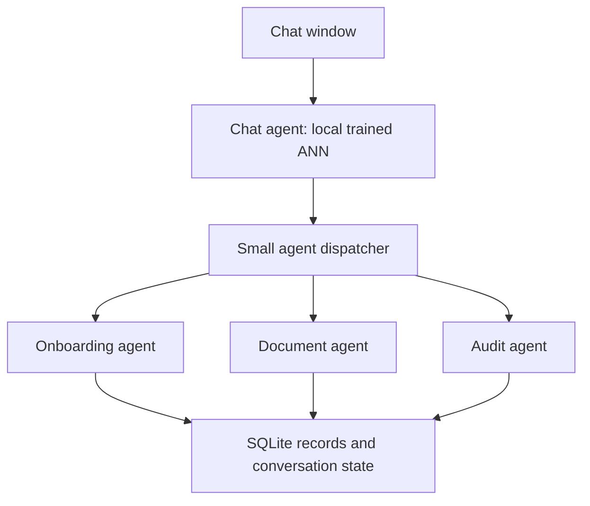

## Extraction, download and ONNX update — 3 November 2026

Install both application and extraction dependencies, then start both services from one terminal:

```bash
python -m pip install -r requirements.txt -r requirements-advo.txt
python run.py
```

Set up `.env` from `.env.example` first. Install the Tesseract executable separately. In `vendor/advo/.env`, set its actual path on Windows, for example `TESSERACT_PATH=C:/Program Files/Tesseract-OCR/tesseract.exe`, and `TESSERACT_LANG=eng`. Leave Gemini fallback disabled. The launcher checks OCR readiness before starting the app and uses the same Python environment for both services. Ctrl+C stops the services it started. It can reuse an already-running healthy extraction service.

Extraction now uses OCR evidence for automatic document typing, rather than forcing the image model's top guess. If Auto fails, choose PAN/Aadhaar/Passbook/Cheque in the inline employee document form and upload again. Empty extraction is an error, not a successful upload. Configuration, connection and OCR failures display their specific cause in chat. Local extraction calls bypass proxy environment variables. The vendor settings load the vendor `.env` explicitly and allow at least 20 seconds for OCR, including when an older `.env` still specifies two seconds.

**Download Excel** now checks the authenticated response, downloads workbook bytes and displays HTTP failures in chat. Export strips invalid Excel control characters from OCR text, which could previously stop workbook generation. All saved employees remain on the single master worksheet.

Chat now runs the bundled **`model/chat/intent_ann.onnx`** using ONNX Runtime. The document model remains **`model/doc_classifier.onnx`**. Training and export are separate: install `requirements-dev.txt` and run `python training/train.py` to retrain and export, or `python training/export_onnx.py` to re-export existing weights. No training or model download is needed to start the app.

**Verification limit:** automatic approval review blocked live startup in this environment due to reported Microsoft telemetry, even after calling the runtime's telemetry opt-out. No further live startup attempts were made. Direct Tesseract extraction, browser download with simulated API responses, and offline ONNX graph checks are recorded in `VALIDATION.md`. Run `python tests/run_offline.py` after installing `requirements-dev.txt` for the reference-interpreter checks. Native runtime live acceptance remains unverified here.

## One master employee sheet

Every chat and confirmed Excel import saves to the same employee register. Conversations only separate messages and pending drafts; they never create separate employee sheets. Use **Master sheet** in chat or type `list` to view the complete register and download `master_employees.xlsx`. The workbook has one worksheet, **Master Employees**, with one row per employee and columns for contact details, client, track, workflow status, verification status and all extracted document fields. New document field columns are added automatically. Existing duplicate-email protection remains active. No conversation filter is applied to the master register. Existing role permissions still determine which records an employee or recruiter can access; the Owner sees all employees. The downloadable workbook is generated from the current saved data each time, so changes appear on the same employee row instead of a new chat-specific sheet.

## Single-window chat UI · AIDO design

The frontend follows the supplied `aido-chat.zip` design: dark surfaces, a 264px sidebar, compact header, purple accents and rounded composer. Mobile conversations open in a drawer. The supplied logo is reused. The onboarding backend and local ANN remain the application engine.

Week 1 opens in a minimal dark chat. Start a conversation, use **Add person**, **Upload Excel**, or **Master sheet**, or type a request. Attach or drag documents into the same window. Choose a person before uploading identity documents. Extracted fields, corrections, audit results and Excel previews appear inline. Confirm before saving or importing.

**New chat** creates an independent intake draft. One conversation can cover one person or several people. Switch between conversations in the sidebar. Transcripts are held only in this browser tab and clear on reload; saved employee records remain available under People. Drafts are isolated on the server per signed-in user and conversation. This is not a durable chat-history service.

Tesseract remains local: no Gemini key is needed. Set `GEMINI_EXTRACTION_FALLBACK_ENABLED=false` and the installed executable path in `vendor/advo/.env`. Set `OCR_REQUEST_TIMEOUT_SECONDS=20` if your existing `.env` still contains `2.0`, then restart ADVO. PAN OCR now reads a sparse-text view as well as block-text views. Accuracy still depends on the scan; confirm extracted fields in chat. This changes OCR processing, not the installed Tesseract version.

# Onboarding: one repository, three branches

The checkout starts on **week-1**. There are no separate weekly application folders.

| Branch | Code in that branch |
| --- | --- |
| `week-1` | Local ANN chat agent, onboarding agent, raw Excel import/export, document agent, audit agent |
| `week-2` | All week-1 code plus Owner/HR/Operations/Employee/Recruiter permissions and role chat |
| `week-3` | All week-2 code plus employee → HR → Operations workflow and notification/resource agents |

```bash
git branch
git switch week-2
git switch week-3
git switch week-1
```

The ZIP contains the complete `.git` directory and all three local branches. Unzip
it normally, including hidden files, then open the single `onboarding` directory.
No Git hosting account or remote connection is required. Stop the app before
switching branches. Week-1 is the recommended starting point.

## Week 1: request flow



The ANN identifies the **intent of the user's message**, not arbitrary source-code
meaning. It is a small domain intent model, not a generative chatbot or code model.
A real model forward pass runs for every `/api/chat` request. Low-confidence or
unknown requests ask for clarification instead of silently choosing a task.

The dispatcher calls a named agent. There is no external orchestration framework,
agent server, vector database or LLM dependency for chat. Agents are small Python
functions in one process. Programmed slot collection, validation and confirmations
make the task predictable; the ANN does not invent employee details.

| Module | Responsibility |
| --- | --- |
| `app/agents/chat.py` | Run `intent_ann.onnx` with ONNX Runtime; infer intent and confidence |
| `app/agents/router.py` | Dispatch intent and conversation context to the correct agent |
| `app/agents/onboarding.py` | Ask for missing details, show preview, accept confirmation |
| `app/people.py` | Validate profile and save a person with audit history |
| `app/excel.py` | Read raw XLSX/XLS rows; export a literal XLSX workbook |
| `app/agents/document.py` | Run supplied ONNX classifier and call ADVO extraction |
| `app/agents/audit.py` | Consistency checks and optional prompt-based audit model |
| `app/main.py` | HTTP endpoints, authentication and storage boundaries |

Permissions and final writes stay in code. The model cannot bypass access checks,
create a role, approve somebody, or save a person without a displayed confirmation.
`agent_trace` and `chat_model` in chat API responses show the actual agent route and
local model prediction. The UI stays simple: welcome, chat, people and task fields.

### Add someone

1. Type `add`, or `please onboard a person`.
2. Onboarding agent asks for full name, email and phone.
3. Review the displayed person and type `confirm`. Type `cancel` to discard.
4. The record is saved once, and appears under People.

A complete prompt also works:

```text
add Ravi Kumar, ravi@example.com, 9876543210
```

For optional fields or corrections use labels:

```text
add name: Ravi Kumar email: ravi@example.com phone: 9876543210 client: EPC track: onboard
```

Other short requests: `import`, `list`, `upload document`, `audit`, `export`, `help`.
Choose a person before uploading a government document or running an audit.
During an open intake, a bare name/email/phone is treated as the requested field;
the model does not need to classify a person's name as a new command.

### Raw Excel input

Upload a `.xlsx` or `.xls` file, preview rows, then confirm Import. Row 1 contains
headers; required columns are name, email, phone. Optional: client, track. Common
headers such as Employee Name, Email ID and Mobile Number work. The first worksheet
is read unless a worksheet name is entered. Limits: 10 MB, 1,000 people, 100 columns.

Invalid/duplicate rows are shown and skipped. Uploading alone never inserts records.
A confirmed batch commits together; a newly detected conflict rolls it all back.
Export downloads a real XLSX containing only records visible to that user. Raw file
bytes are not retained. SQLite holds the editable records and workflow state.
No Google Sheets or other online-sheet connection is used.

## Start week 1

Use Python 3.12. From the repository root:

```bash
python -m venv .venv
# Windows PowerShell:
.venv\Scripts\Activate.ps1
# Linux/macOS instead: source .venv/bin/activate
python -m pip install -r requirements.txt -r requirements-advo.txt
```

Copy `.env.example` to `.env`. Set BOOTSTRAP_EMAIL and your own BOOTSTRAP_PASSWORD
(16+ characters). The example password is rejected. Keep APP_URL=http://localhost:8000
when using that address. Local `localhost`, `127.0.0.1` and `[::1]` addresses are
accepted interchangeably on the same scheme and port. If using a custom hostname,
LAN IP, public domain or different port, set APP_URL to that exact browser origin
(no path), then restart the application. Do not use `*` or `0.0.0.0` as APP_URL;
`0.0.0.0` is a bind address, not the browser address. Then run:

```bash
python -m uvicorn app.main:app --host 127.0.0.1 --port 8000
```

Open http://localhost:8000 and sign in. Week-1 has one Operator who can onboard
any person. Chat and Excel work immediately: the trained ANN is included, with no
API key, runtime training or model download.

For document extraction, install the Tesseract executable and English trained data.
In a second terminal, activate the same environment and run:

```bash
cd vendor/advo
# Copy .env.example to .env. Set TESSERACT_PATH if it is outside PATH.
python -m uvicorn app.extraction_main:app --host 127.0.0.1 --port 8001
```

Or use Docker after creating `.env`: `docker compose up --build`.
The local chat ANN works even if the document service is stopped. Uploading a
private document requires that extraction service; failure is shown explicitly.
The vendor directory is an extraction-only subset of the supplied ADVO code.

## The trained chat model

- Custom ANN: normalized word/bigram features → Dense(48, ReLU) → 17 intent scores. Trained with NumPy; served using ONNX Runtime.
- `model/chat/intent_ann.onnx`: included inference model. `weights.npz` preserves its training weights; it is not used for live chat inference.
- `training/export_onnx.py`: exports the training weights, checks the ONNX graph and compares predictions on all 345 training/evaluation phrases. `model/chat/onnx_export.json` records the result.
- This is a custom intent ANN, with no pretrained chat-LLM base. ONNX is the exported graph format, not a training model. It identifies onboarding intents; it does not generate free-form conversation.
- `training/intents.json`: 273 curated English training examples, all synthetic.
- `training/evaluation.json`: 72 separate held-out example messages.
- `model/chat/evaluation.json`: actual evaluation results, including rejected cases.
- Retrain locally: `python training/train.py`. Training overwrites only chat-model
  files; it never retrains or replaces the supplied document classifier.

Observed held-out top-1 accuracy: **97.2%**. With the conservative confidence/margin
guard, **78.1% of known-task examples were accepted**; uncertain cases ask for a
shorter command. Guarded accuracy across the whole held-out set was **80.6%**.
These are small prototype examples, not production accuracy or a calibrated
probability. English domain coverage is limited; synonyms, multilingual requests
and unusual wording require more labelled examples and fresh evaluation.

To improve it, add representative training phrases, keep new evaluation phrases
separate, retrain and inspect the report. Merely editing the JSON does not change
runtime predictions until the weights are retrained. There is no silent regex
fallback if model files are missing: startup fails so the issue can be corrected.

## Documents and audit

The original local ONNX document model classifies Aadhaar, PAN, passbook and cheque.
ADVO extracts their fields. Review/correct them, Confirm fields, then Audit. Original
uploaded bytes are discarded after processing; extracted fields stay in SQLite.

`app/prompts/verification.txt` is read on each audit. With no audit-model endpoint,
local consistency checks run. If required, configure AGENT_URL/AGENT_MODEL/AGENT_API_KEY
for a local OpenAI-compatible audit model. These settings never handle chat intent.
OCR, consistency checks and the ANN do not authenticate government documents or
perform an authoritative DL/background check. Those require manual review or a
future authorized provider. Audit status remains needs_review.

## Later branches

Week-2 adds role/account modules to this same application. Owner can chat:
`add user name: Neha email: neha@example.com role: hr_admin`, then confirm. One-use
activation links let users choose passwords. `set role neha@example.com operations`
also requires confirmation. Employees see only their own record; recruiters only
people they created. Import/export follows those permissions.

To preserve week-1 data: stop the app, back up SQLite, switch to week-2, keep the
same DATABASE_PATH and original bootstrap credentials, run `python -m app.setup_owner`,
then restart. It promotes only the sole Operator after checking those credentials.
Week-3 adds email-claim metadata automatically. Do not reuse the database from the
older Google Sheets prototype: import an Excel export into this repository instead.

Week-3 adds submit → HR review → separate Operations approval, correction requests,
resource mapping and queued SMTP email. Explicit task actions/notes and server checks
remain mandatory even when the ANN identifies an approval intent. Configure SMTP
and run `python -m app.worker`, or `docker compose --profile workflow up --build`.
No email service is needed for week-1 chat/Excel intake.

## Checks and limits

```bash
python -m pip install -r requirements-dev.txt
python -m pytest tests -q
python -m compileall -q app
node --check app/static/app.js
node --test tests/test_api_errors.cjs
```

See VALIDATION.md for executed results. This is a small single-instance starter.
Protect private SQLite data, use backups and HTTPS before external deployment.
Docker, visual browser acceptance and live SMTP/model/provider checks may still
need environment-specific verification as listed in that file.
