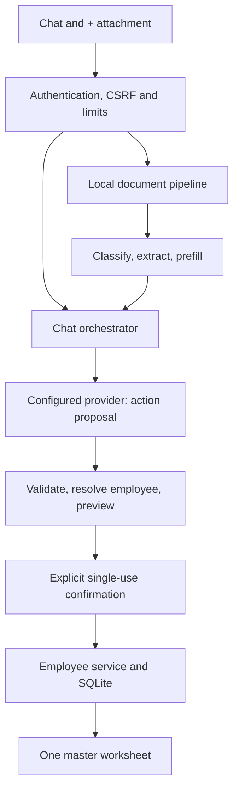

# Architecture

## One server

A single Uvicorn worker hosts FastAPI and same-origin static assets. Authentication, orchestration, classification, Tesseract extraction and persistence are local modules. Tesseract is a local executable invoked by the OCR library, not an HTTP service. The optional document ONNX model is local too. No legacy chat ANN/MiniLM weights, model training process, ADVO service or port 8001 is used.

## Provider contract

One allowed `propose_action` function covers read/list/create/update/delete/upload/audit/export/cancel/reply. Each adapter maps its provider's response into the same validated `Plan`. Unknown tools, extra fields, malformed JSON, multiple tool calls and upstream failures are rejected. The model never obtains a database handle. The server does not let a provider propose `confirm`.

Only successful authoritative service operations produce the application's write/delete status replies. Free-text model replies remain untrusted model output. Context includes at most eight prior messages and the selected employee's basic ID/name/contact/client/track/status. It excludes uploaded file bytes, passwords, session/CSRF tokens, provider credentials and extracted document fields. Chat text itself can contain personal information.

## OCR details

Typing uses local text evidence. A high-contrast header view helps identify coloured/grainy cards even when the PAN number is not yet legible. For a supported classic landscape PAN layout, local region OCR accepts a combined candidate only when the PAN pattern, two plausible names and a valid past birth date are all read; other layouts fall back to multi-view OCR. No fixture/hash lookup is used in real mode. This is a template-specific fallback and is not evidence of universal scan accuracy. User review remains required.

## Concurrency

Document processing is synchronous in FastAPI's worker thread pool and bounded by an application semaphore. Defaults allow one OCR request at a time. A saturated slot returns 429; it does not create an unbounded queue. Each Tesseract call has a timeout and the candidate pass has a bounded OCR budget. Specialized extraction may take longer than one candidate pass; the reverse-proxy timeout is 120 seconds.

Provider/OCR calls occur outside long database write transactions. Conversation versions detect parallel messages/attachments. Employee versions detect changes that occurred while OCR was running or while a confirmation was pending. Mutations use `BEGIN IMMEDIATE`, parameterized SQL and transactional audit writes. SQLite WAL and busy timeout support the documented single-worker/single-tenant deployment, not horizontal scaling.

## Persistence

- `users`: Argon2id credentials; legacy scrypt hashes are upgraded on successful login.
- `auth_sessions`: SHA-256 hashes of random tokens, absolute expiry and last-seen time.
- `auth_attempts`: short-lived HMAC-hashed IP/account throttle subjects.
- `employees`, `documents`, `audit`: canonical register, extracted values and change history.
- `chat_conversations`, `chat_messages`: user-scoped state and persistent messages.
- `pending_actions`: ten-minute, user/conversation-scoped, single-use mutation previews.
- `document_previews`: expiring extraction result before employee creation.
- `imports`: ten-minute workbook previews and confirmation status.

Additive startup migration preserves employees/documents/audit and users from the previous week 1 database. It invalidates old raw sessions, adds soft-deletion support and creates new auth/chat tables. Old conversation drafts/messages are not imported into the new chat schema. Take a backup before migration. Historical week 2/3 databases and roles are not supported upgrade paths.
